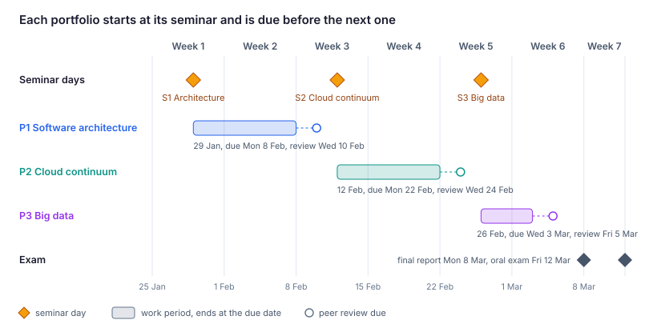
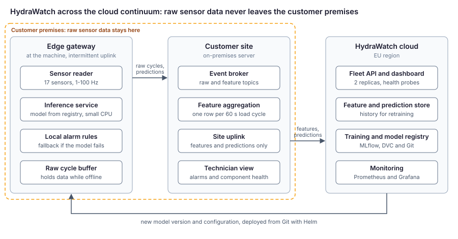
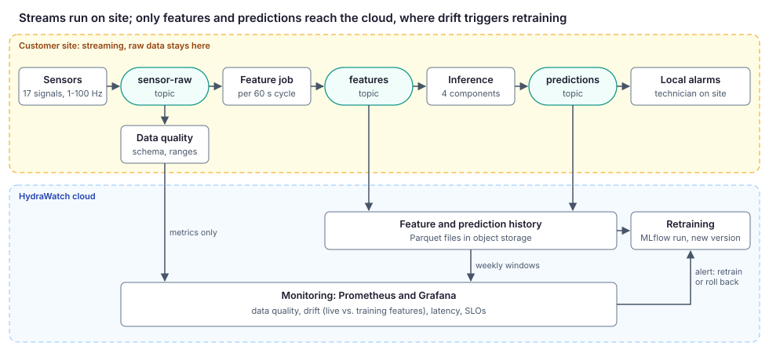

# Portfolio Proposal: Own Case, Anchored in the Seminar Themes

Draft for the course responsible and teaching staff, 27 October 2026.

## Summary

Students bring their own case from their company, and each portfolio applies one seminar theme to that case. The self-study weeks (MLOps in week 4, observability in week 6) feed the portfolios but do not anchor them. A fictional reference case, **HydraWatch**, is the worked example for every portfolio, the basis of the hands-on reference project, and the fallback for students who cannot use a company case.

| Portfolio | Anchor | Core question | Introduced | Due |
| --- | --- | --- | --- | --- |
| P1 | Seminar 1: Software architecture | What must the system achieve, and which structure achieves it? | Fri 29 Jan | Mon 8 Feb |
| P2 | Seminar 2: Cloud continuum | Where does each part run, and how is it secured, deployed and kept reliable? | Fri 12 Feb | Mon 22 Feb |
| P3 | Seminar 3: Big data & data science technologies | How is data ingested, processed, stored and governed, and how do we notice when it changes? | Fri 26 Feb | Wed 3 Mar |

Each portfolio is peer-reviewed two days after its deadline and discussed at the next seminar. The final report (due Mon 8 Mar) is P1–P3 revised after feedback, plus a reflection.

## Bringing your own case

A suitable case has four things:

1. **An AI component**, existing or planned. A model in a notebook is enough.
2. **A deployment context with at least two places to run**, e.g. device, plant, office server and cloud.
3. **Data that keeps arriving**, e.g. sensor readings, transactions, logs or documents.
4. **At least one constraint that matters**, e.g. latency, availability, privacy, data sovereignty or cost.

How a case is chosen and approved:

- Students pitch their case at Seminar 1 in 3 minutes: context, users, data, why ML, and the constraint that matters.
- The lecturer approves the case by Wed 3 Feb, or points the student to the fallback.
- Groups (at most 3 students) share one case.

Confidentiality:

- Describe the system at the level of components and data types, and anonymise names.
- Where data is needed, use synthetic or public data with the same shape.
- **Company data never goes on the course cluster.** Every student has read access to the whole cluster, including other namespaces.

Hands-on evidence:

- When the own case cannot run with public or synthetic data, the hands-on parts are shown on the HydraWatch reference project.
- The analysis and design still concern the own case.

Fallback: students without a suitable case, or blocked by confidentiality, use HydraWatch for all three portfolios with the same deliverables.

## P1 – Software architecture (Seminar 1)

P1 turns a business problem into measurable requirements and an architecture.

**Guiding questions for the own case**

- Who are the stakeholders, and what is the business goal?
- Which quality attributes matter most, and which ones conflict?
- Which parts are AI and which are not, and how do they interact?
- Which technical debt will the design accumulate?

**Deliverables**

- Problem, stakeholders and why ML is needed
- 3–5 quality-attribute scenarios in six-part form: source, stimulus, environment, artefact, response, measure
- C4 context and container diagrams, with the AI and non-AI parts marked
- At least two architecture decision records (ADRs) with the alternatives considered
- Technical-debt risks and how the design limits them

**Worked example: HydraWatch.** The numbers are invented targets for teaching.

| Quality | Stimulus | Environment | Response | Measure |
| --- | --- | --- | --- | --- |
| Performance | A 60 s load cycle completes | Normal operation | Gateway classifies all four components | Result within 2 s of cycle end |
| Availability | Uplink to the cloud drops | Ship at sea | Gateway keeps classifying, raises local alarms, buffers results | No alarm lost during 72 h offline |
| Modifiability | Data scientist registers a new model version | Development | New version rolls out without code changes | Live on all gateways within 1 working day |
| Privacy | Customer requires raw data to stay on site | Production | Only per-cycle features and predictions leave the site | 0 raw samples leave the site, shown in logs |
| Model quality | A cycle with severe internal pump leakage occurs | Production | The model flags the pump | Recall at least 0.95 on cycles held out by time; a missed leak costs an unplanned stop |

ADRs:

1. **Where inference runs:** on the gateway for alarms, and in the cloud for the fleet view. Rejected: cloud-only, which fails the availability and privacy scenarios.
2. **Interface styles:** event streaming for sensor data, and REST for prediction requests and the service desk. Rejected: REST polling, which does not scale to 100 Hz signals.
3. **Model versions:** the model registry is the single source of truth. Rejected: models copied into images by hand.

Technical-debt risks:

- 17 sensor inputs with undeclared dependencies.
- Glue code between the 1–100 Hz signals and the per-cycle features.
- A feedback loop: technicians replace parts after alarms, which biases future labels.

**Proposed assessment criteria**

- The scenarios are measurable and traceable to the business goal.
- The diagrams are consistent with the scenarios and the ADRs.
- The ADRs name real alternatives and the trade-off that decided them.
- The debt risks are specific to the case, not a generic list.

## P2 – Cloud continuum (Seminar 2)

P2 places each part of the P1 architecture on the continuum, from edge to cloud. It then shows how the system is secured, deployed and kept reliable. MLOps from week 4 supports P2: building and deploying reproducibly is how the placement becomes real.

**Guiding questions for the own case**

- Which component runs where (edge, on-premises or cloud), and why?
- Which data may leave which tier, and which rule says so (contract, GDPR, customer policy)?
- How is the infrastructure secured: network boundaries, secrets, least privilege?
- How does heterogeneous compute (small devices, CPUs, GPUs) constrain the choice of model?
- What happens when a part fails or the connection drops?
- How is the system built and deployed reproducibly? (Supporting, week 4.)

**Deliverables**

- Deployment view: which component runs on which tier, traced to the P1 scenarios
- Data-placement table: each data item, where it may be stored and processed, and the rule behind it
- Security and reliability tactics, mapped to the components they protect
- Kubernetes manifests or a Helm chart, plus the CI and deployment workflow (own case or reference project)
- Evidence: repository link, `kubectl get all`, and a deleted pod or a failed model showing recovery

**Worked example: HydraWatch**

The course cluster gives each student one namespace with no traffic in or out. Images come from public registries, and students deploy from their laptops. The three tiers are therefore simulated inside the namespace:

| Tier | Simulated as | Runs |
| --- | --- | --- |
| Edge gateway | A deployment with tight limits (e.g. 250m CPU, 256 Mi), 1 replica | Inference service, local alarm rules, raw cycle buffer |
| Customer site | A separate deployment behind a NetworkPolicy boundary | Event broker, feature aggregation, the only link to the cloud tier |
| HydraWatch cloud | Deployments with 2+ replicas | Fleet API, feature store, MLflow registry, monitoring |

- **Data sovereignty:** a NetworkPolicy lets only the site uplink reach the cloud tier, so raw cycles never leave the gateway or site pods.
- **Reliability:** every service has readiness and liveness probes, and the fleet API runs 2 replicas. If the model fails to load, the gateway falls back to fixed thresholds on cooling efficiency and pressure.
- **Supporting MLOps:**
  - Training runs are logged to MLflow through port-forward, and the dataset is versioned with DVC.
  - CI pushes images to a public registry.
  - `make deploy` runs `helm upgrade --install` with the image tag and model version committed in Git, and `kubectl diff` shows drift.

**Proposed assessment criteria**

- Placement decisions follow from the P1 quality attributes and constraints.
- Data flows respect the stated sovereignty rules, and the design enforces them.
- At least one security and one reliability tactic are demonstrated, not only described.
- A model can be rebuilt from Git, DVC and an MLflow run id, and one command deploys the system.

## P3 – Big data & data science technologies (Seminar 3)

P3 designs how data flows through the system, how it is stored and governed, and how changes in the data are noticed. Observability from week 6 supports P3: drift and data quality are watched on the data the pipeline produces.

**Guiding questions for the own case**

- What data does the system produce and consume, at what volume and rate?
- Batch, stream or both, and why?
- Where are historical and event data stored: topic retention, data lake, warehouse, feature store?
- Who owns which data, how long is it kept, and which privacy and fairness rules apply?
- How is data quality checked, and how is drift detected and acted on? (Supporting, week 6.)

**Deliverables**

- Data-flow diagram from source to storage to model, marking the tier boundaries from P2
- Volume and rate estimate, with the calculation shown
- Processing choice (batch, stream or both) and storage choice, each with an ADR
- Governance table: data item, owner, retention, rule, location
- Data-quality checks, drift metrics, SLOs and the feedback loop (retrain, roll back or reconfigure)
- Evidence: a running pipeline and a dashboard showing an injected drift (own case or reference project)

**Worked example: HydraWatch**

- **Volume:** one load cycle holds 43,680 values: 7 signals at 100 Hz, 2 at 10 Hz and 8 at 1 Hz, over 60 s. At 8 bytes per value that is about 350 kB per cycle. At 1,440 cycles per day that is about 500 MB per machine per day, or about 50 GB per day for a fleet of 100 machines. That is the argument for keeping raw data on site and sending only per-cycle features.
- **Processing:** the 2,205 dataset cycles are replayed as events into a single-node Kafka-compatible broker (e.g. Redpanda) in the namespace. The topics are `sensor-raw` → `features` → `predictions`, with local alarms on site.
- **Storage:** raw topics are kept on site with short retention (proposed: 7 days). Features and predictions are batched to Parquet in object storage (e.g. MinIO in the namespace) and kept for retraining.
- **Governance:** the customer owns raw data, and HydraWatch processes features under contract. Labels come from technician confirmations, with the bias risk noted in P1.
- **Quality and drift:**
  - Schema and range checks run on `sensor-raw`.
  - Weekly feature distributions are compared with the training data.
  - Drift is injected by replaying more degraded-cooler cycles or adding a sensor offset.
  - A drift alert triggers retraining in MLflow, or a rollback through Git.

**Proposed assessment criteria**

- The volume estimate is calculated and drives the processing and storage choices.
- The governance rules are concrete and consistent with the P2 data-placement table.
- Drift and quality signals are defined, measured and tied to an action.
- The feedback loop is demonstrated, not only described.

## Reference case: HydraWatch

HydraWatch A/S is a fictional Danish SME that monitors the health of industrial hydraulic systems on ships, wind turbines and production lines. Its data scientists predict component wear in notebooks today. Management wants a production service that warns technicians before a component fails.

| Aspect | Case detail |
| --- | --- |
| Stakeholders | Customer maintenance technicians (on-site alarms), HydraWatch service desk (fleet overview), data science team (models), customer IT/security (approves data flows), management (cost, SLA) |
| Data | *Condition monitoring of hydraulic systems* (Helwig, Pignanelli & Schütze, 2015; UCI Machine Learning Repository; CC BY 4.0; doi:10.24432/C5CW21). 2,205 load cycles of 60 s from a hydraulic test rig; 17 sensors (pressure, motor power, flow, temperature, vibration, cooling, efficiency) at 1–100 Hz; 73.1 MB download; no missing values. |
| ML task | Per cycle, classify four components: cooler (3/20/100 %), valve (100/90/80/73 %), internal pump leakage (none/weak/severe) and accumulator (130/115/100/90 bar), plus a stable/unstable flag |
| Tiers | Sensor gateway at the machine (edge), customer server (on-premises), HydraWatch cloud (training, registry, fleet view) |
| Constraints (invented) | Raw sensor data belongs to the customer and stays on site; only features and predictions may leave. Alarms must reach the technician even when the uplink is down. |

The dataset is real and openly licensed, so the reference project runs on real sensor data. It comes from a single test rig: split it by time or block, not randomly, and treat fleet-level generalisation as a stated limitation. The company and its constraints are invented, so that each seminar theme has a concrete decision to make.

## Reference project and workload

| Week | Reference project step (HydraWatch) | Portfolio work |
| --- | --- | --- |
| 1 | Baseline notebook on the dataset; cluster access | Case pitch at Seminar 1; P1 starts |
| 2 | Package, tests, FastAPI service, Docker image | P1 |
| 3 | Deploy the three tiers to the namespace; probes, limits, NetworkPolicy | P1 due Mon; P2 starts at Seminar 2 |
| 4 | MLflow, DVC, CI to a public registry, Helm deploy from Git | P2 |
| 5 | Redpanda topics, streaming features and inference, Parquet history | P2 due Mon; P3 starts at Seminar 3 |
| 6 | Prometheus and Grafana, drift injection, retrain or roll back | P3 due Wed |
| 7 | – | Final report Mon 8 Mar; oral exam Fri 12 Mar (SDU Odense, U165) |

Proposed workload for 5 ECTS (about 137 hours):

| Activity | Hours |
| --- | --- |
| Seminars (3 × 7 h) | 21 |
| Required reading | 35 |
| Reference project (core exercises) | 30 |
| P1 | 15 |
| P2 | 15 |
| P3 | 12 |
| Final report and exam preparation | 10 |

## Open decisions

- **Page limits:** the final report is 15–20 pages (decided); a per-portfolio limit is open (suggested 5–7 pages).
- **Case approval deadline:** proposed Wed 3 Feb.
- **Grading of portfolios:** proposed feedback only, with only the final report and oral exam graded.
- **Dataset hosting:** the site must not link externally, so a cleaned copy (with the CC BY attribution) goes in the reference-project repository. Where should that repository live?
- **Cluster permissions:** cluster-wide read access currently includes secrets in other namespaces. Should `secrets` be removed from the read-only ClusterRole before the course starts?
- **Guest talk (Seminar 3, TBC):** could be connected to the case domain.
